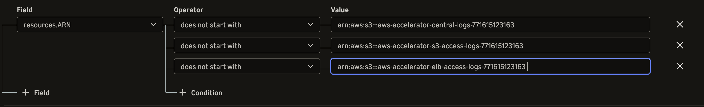

## CloudTrail Optimizations
LZA 1.17.0 [release](https://github.com/awslabs/landing-zone-accelerator-on-aws/releases/tag/v1.17.0) describes an update to address a log delivery loop:

> When cloudwatchLogs.subscription.type is ACCOUNT and selectionCriteria is omitted, LZA now excludes its own Firehose records-processor log group in the Log Archive account by default, which prevents a log delivery loop. If you provide selectionCriteria, include that exclusion yourself. This resolves [1193](https://github.com/awslabs/landing-zone-accelerator-on-aws/issues/1193).

This fix doesn't apply to Org Trails, but to take advantage of this optimization follow these steps until it becomes configurable in LZA. These steps should be first executed in a test environment if possible.

### Identify Pre-Fix Logging

- In the Management Account, navigate to *CloudWatch Logs*, and then *Log Analytics*
- Execute the following query which looks at the number of S3 PutObjects in the Log Archive Account grouped by S3 Bucket.

```
SOURCE "aws-accelerator-cloudtrail-logs" START=-1w END=0s |
filter recipientAccountId = '<log archive account id>' and eventName = 'PutObject'
| stats count(*) as eventCount by requestParameters.bucketName as BucketName
| sort eventCount desc
```

### Identify S3 Buckets in Log Archive

- In the Log Archive Account, open a CloudShell instance, and query existing buckets

```
aws s3 ls
```

and you might see buckets similar to this:

```
2026-04-22 18:28:18 aws-accelerator-central-logs-771615123163-ca-central-1
2026-04-29 08:37:40 aws-accelerator-elb-access-logs-771615123163-ap-northeast-1
2026-04-22 16:02:53 aws-accelerator-elb-access-logs-771615123163-ap-northeast-2
2026-04-20 21:47:27 aws-accelerator-elb-access-logs-771615123163-ap-northeast-3
2026-04-21 23:30:11 aws-accelerator-elb-access-logs-771615123163-ap-south-1
2026-04-23 21:32:37 aws-accelerator-elb-access-logs-771615123163-ap-southeast-1
2026-04-22 00:17:20 aws-accelerator-elb-access-logs-771615123163-ap-southeast-2
2026-04-22 17:52:26 aws-accelerator-elb-access-logs-771615123163-ca-central-1
2026-04-30 05:16:51 aws-accelerator-elb-access-logs-771615123163-eu-central-1
2026-04-17 20:49:27 aws-accelerator-elb-access-logs-771615123163-eu-north-1
2026-04-30 07:04:07 aws-accelerator-elb-access-logs-771615123163-eu-west-1
2026-04-23 21:16:10 aws-accelerator-elb-access-logs-771615123163-eu-west-2
2026-04-17 18:06:41 aws-accelerator-elb-access-logs-771615123163-eu-west-3
2026-04-23 18:14:09 aws-accelerator-elb-access-logs-771615123163-sa-east-1
2026-04-29 20:26:20 aws-accelerator-elb-access-logs-771615123163-us-east-1
2026-04-29 08:20:03 aws-accelerator-elb-access-logs-771615123163-us-east-2
2026-04-22 19:51:42 aws-accelerator-elb-access-logs-771615123163-us-west-1
2026-04-27 14:47:58 aws-accelerator-elb-access-logs-771615123163-us-west-2
2026-04-28 19:42:03 aws-accelerator-s3-access-logs-771615123163-ap-northeast-1
2026-04-22 16:51:30 aws-accelerator-s3-access-logs-771615123163-ap-northeast-2
2026-04-20 21:35:15 aws-accelerator-s3-access-logs-771615123163-ap-northeast-3
2026-04-22 02:33:15 aws-accelerator-s3-access-logs-771615123163-ap-south-1
2026-04-23 20:25:33 aws-accelerator-s3-access-logs-771615123163-ap-southeast-1
2026-04-22 01:32:04 aws-accelerator-s3-access-logs-771615123163-ap-southeast-2
2026-04-22 18:39:39 aws-accelerator-s3-access-logs-771615123163-ca-central-1
2026-04-29 22:38:39 aws-accelerator-s3-access-logs-771615123163-eu-central-1
2026-04-17 20:41:47 aws-accelerator-s3-access-logs-771615123163-eu-north-1
2026-04-29 21:33:45 aws-accelerator-s3-access-logs-771615123163-eu-west-1
2026-04-23 23:43:44 aws-accelerator-s3-access-logs-771615123163-eu-west-2
2026-04-17 19:42:24 aws-accelerator-s3-access-logs-771615123163-eu-west-3
2026-04-23 17:20:08 aws-accelerator-s3-access-logs-771615123163-sa-east-1
2026-04-29 19:29:17 aws-accelerator-s3-access-logs-771615123163-us-east-1
2026-04-28 20:37:43 aws-accelerator-s3-access-logs-771615123163-us-east-2
2026-04-22 21:23:38 aws-accelerator-s3-access-logs-771615123163-us-west-1
2026-04-27 20:30:57 aws-accelerator-s3-access-logs-771615123163-us-west-2
```

- Identify the common bucket name prefixes. In the example above they are:
  - aws-accelerator-central-logs-771615123163
  - aws-accelerator-s3-access-logs-771615123163
  - aws-accelerator-elb-access-logs-771615123163

### Apply an Advanced Selector Rule to CloudTrail

- In the Management Account, navigate to *CloudTrail*, and *Trails*
- Identify the Org Trail created by LZA. E.g. *AWSAccelerator-Organizations-CloudTrail*.
- Locate the *Data Events* section. You may see *Basic event selectors are enabled*.
- Click the *Switch to advanced event selectors*, and make the following changes
  - Resource Type: Choose 'S3'
  - Log selector template: Choose 'Custom'
  - In the Advanced Event Selector rule builder, create rules to exclude the identified buckets in the previous step. Note the use of bucket ARN, not bucket name.
    - Ensure there are no starting or ending whitespaces. 

  


### Identify Post-Fix Logging

- In the Management Account, navigate to *CloudWatch Logs*, and then *Log Analytics*
- After a day, execute the following query which looks at the number of S3 PutObjects in the Log Archive Account grouped by S3 Bucket.

```
SOURCE "aws-accelerator-cloudtrail-logs" START=-1w END=0s |
filter recipientAccountId = '<log archive account id>' and eventName = 'PutObject'
| stats count(*) as eventCount by requestParameters.bucketName as BucketName
| sort eventCount desc
```


